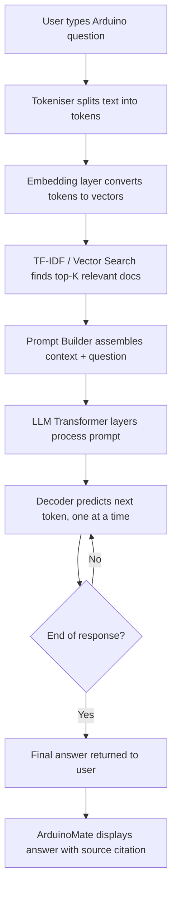

# How LLMs Work — ArduinoMate Day 5

**Student:** Parth Dasharath Katore | Enroll: 2124UCEM2079 | Roll: 53

---

## 1. What is an LLM?

A **Large Language Model (LLM)** is a type of AI model trained on massive amounts of text data — books, websites, code, documentation — to understand and generate human language. Examples include GPT-4, Claude, and Gemini.

The word *large* refers both to the size of the training data (trillions of words) and to the number of internal parameters (billions of numeric weights) the model uses to store what it has learned.

An LLM does not store facts like a database. Instead it learns statistical patterns: given a sequence of words, what word (or token) is most likely to come next?

---

## 2. How Does an LLM Work?

At a high level an LLM goes through two phases:

### Phase 1 — Pre-training
The model reads enormous amounts of text and learns to predict the next token. Through billions of repetitions it adjusts its internal weights until it gets very good at this task. This is where most of the "knowledge" is absorbed.

### Phase 2 — Fine-tuning / RLHF
The base model is then further trained on curated question-answer pairs and rated by humans so it learns to give helpful, safe, and accurate responses rather than just statistically likely ones.

### At Inference Time (when you ask a question)
1. Your text is broken into **tokens**.
2. Each token is converted to a numeric **embedding** vector.
3. The vectors pass through many **Transformer** layers (attention + feed-forward).
4. The model outputs a probability distribution over all possible next tokens.
5. The highest-probability token is selected, appended to the output, and the process repeats until the response is complete.

---

## 3. What Are Tokens?

A **token** is the smallest unit of text an LLM processes. Tokens are not exactly words — they are chunks determined by a tokenizer algorithm (usually Byte-Pair Encoding).

| Text | Tokens |
|------|--------|
| `digitalWrite` | `digital` `Write` |
| `pinMode(13, OUTPUT)` | `pin` `Mode` `(` `13` `,` `OUTPUT` `)` |
| `Hello!` | `Hello` `!` |

Rule of thumb: ~1 token ≈ 0.75 English words, or ~4 characters.

**Why it matters for ArduinoMate:** Arduino function names like `attachInterrupt` or `analogReference` may be split into multiple tokens. This affects how well an LLM "sees" them and influences search quality.

---

## 4. What Are Embeddings?

An **embedding** is a list of numbers (a vector) that represents the meaning of a word, sentence, or document in a high-dimensional space. Concepts that are semantically similar end up close to each other in this space.

Example:
- `analogRead` and `analogWrite` → vectors that are close together (both Analog I/O)
- `delay` and `millis` → vectors that are close together (both Time functions)
- `delay` and `Serial.begin` → vectors that are far apart (unrelated)

ArduinoMate's current smart search uses **TF-IDF vectors** (a simpler, non-neural form of embeddings). Future versions will use dense neural embeddings from a sentence-transformer model, which captures meaning even when exact words don't match.

---

## 5. What Is a Prompt?

A **prompt** is the input text you send to an LLM. It tells the model what you want it to do. Prompts can include:

- **Instructions** — "Explain what `digitalRead()` does."
- **Context** — Paste in relevant Arduino documentation.
- **Examples** — Show the model a few question-answer pairs.
- **Constraints** — "Reply in under 100 words, for a beginner."

In ArduinoMate's planned LLM integration the prompt will be automatically constructed by combining:
1. The user's raw question.
2. The top-ranked Arduino reference records retrieved by TF-IDF search.
3. A system instruction telling the LLM to stay on-topic and cite the official docs.

---

## 6. What Is Context?

**Context** (also called the *context window*) is everything the LLM can "see" in a single conversation turn — your prompt plus any previous messages. It is measured in tokens.

| Model | Approx. Context Window |
|-------|------------------------|
| GPT-3.5 | 4 096 tokens |
| GPT-4 | 8 192 – 128 000 tokens |
| Claude 3 | up to 200 000 tokens |

**Why it matters for ArduinoMate:** We cannot paste the entire Arduino reference into every prompt. The search pipeline (TF-IDF → ranked records) selects only the most relevant 2–3 records to include in the context window. This keeps costs low and answers focused.

---

## 7. What Is an AI Hallucination?

**Hallucination** is when an LLM confidently generates text that sounds plausible but is factually wrong or completely made up.

**Example in an Arduino context:**  
A hallucinating model might say:  
> "The `digitalRead()` function returns a float between 0.0 and 5.0 representing the pin voltage."

This is wrong — `digitalRead()` returns only `HIGH` (1) or `LOW` (0).

**How ArduinoMate mitigates hallucination:**  
- The official Arduino .adoc documentation is the *only* knowledge source.
- The LLM prompt will include the actual documentation text as grounding context.
- If no relevant record is found, ArduinoMate will say so rather than guess.

---

## 8. Traditional Search vs. Semantic Search

| Feature | Traditional Search | Semantic Search |
|---|---|---|
| Matching method | Exact keyword / substring match | Meaning and concept similarity |
| Query: "how to blink an LED" | Only matches records with the words *blink* and *LED* | Also matches records about `digitalWrite`, PWM, pin output |
| Query: "stop my code from freezing" | No match (no such words in docs) | Matches `delay()` gotcha about blocking execution |
| Handles typos | No | Yes (embeddings are robust) |
| Implementation | `str.contains()` or SQL LIKE | TF-IDF, sentence embeddings, vector DB |

ArduinoMate currently uses **TF-IDF cosine similarity** (a bridge between the two), and will upgrade to full neural semantic search in a later week.

---

## 9. How Will LLMs Be Used in ArduinoMate?

The planned pipeline for the full ArduinoMate system:

```
User Question
      │
      ▼
  [Embedding / TF-IDF Search]
      │  (find the top 3 relevant Arduino reference records)
      ▼
  [Prompt Builder]
      │  (system instruction + retrieved docs + user question)
      ▼
  [LLM API Call]  ← GPT-4 / Claude / local Ollama model
      │
      ▼
  [Answer with citation]
      │
      ▼
  User gets a grounded, hallucination-resistant reply
```

This pattern is called **RAG — Retrieval-Augmented Generation**.

---

## 10. LLM Workflow Diagram (Mermaid)



---

*Document version: Week 1 — Day 5*  
*Data source: Official Arduino Reference — https://github.com/arduino/reference-en*
