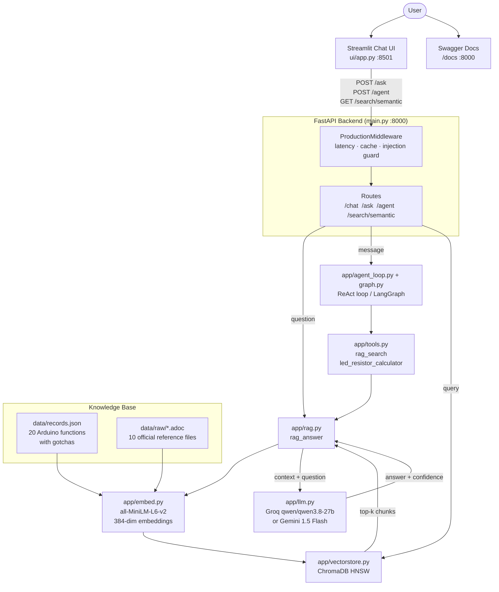

# ArduinoMate

[](https://github.com/parthkatore/GENAI/actions/workflows/ci.yml)
[](https://arduinomate-api.onrender.com)
[](https://python.org)
[](https://fastapi.tiangolo.com)

**An AI-powered Arduino learning assistant. Ask questions in plain English; get grounded answers from official Arduino documentation — with citations, a resistor calculator, and a Streamlit chat interface.**

---

## The Problem

Arduino beginners face a consistent set of blockers: they need answers about specific functions, but general-purpose AI tools hallucinate syntax, invent pin numbers, and give wrong answers about differences between boards like the Uno, Nano, and ESP32. Official documentation is accurate but hard to navigate for a beginner.

ArduinoMate solves this with **Retrieval-Augmented Generation (RAG)**: every answer is grounded in retrieved documentation chunks, every claim comes with a source citation, and out-of-scope questions get an honest "I don't know" rather than a fabricated answer.

---

## Architecture



---

## Results

### RAG evaluation — 15 questions, two configurations

| Metric | Config A (chunk=300, top_k=3) | Config B (chunk=500, top_k=5) |
|--------|-------------------------------|-------------------------------|
| Answer rate (13 in-scope Qs) | 85% | **100%** |
| Refusal rate (2 out-of-scope Qs) | **100%** | **100%** |
| Source hit rate | 92% | **100%** |
| Avg chunks retrieved | 3.0 | 5.0 |
| Avg latency | **4.4 s** | 8.3 s |
| Composite score | 0.912 | **1.000** |

Config B wins on every accuracy metric. Config A's lower latency is not worth the missed answers on multi-function questions like `millis()` + `attachInterrupt()`.

### Semantic search — 10 manual queries

| Query | Top hit | Score | Correct? |
|-------|---------|-------|----------|
| `pinMode` | pinMode() | 0.361 | Yes |
| `digitalRead button INPUT_PULLUP` | pinMode (INPUT_PULLUP) | 0.757 | Yes |
| `delay vs millis non-blocking` | attachInterrupt (mentions both) | 0.785 | Yes |
| `PWM analogWrite duty cycle` | analogWrite() | 0.793 | Yes |
| `analogRead floating pin noise` | analogRead() notes | **0.819** | Yes |
| `HC-SR04 ultrasonic` *(out-of-scope)* | pulseIn (low score) | 0.422 | Yes — correctly low |
| `serial monitor baud rate` | Serial.begin() | **0.848** | Yes |
| `attachInterrupt ISR volatile` | attachInterrupt | 0.754 | Yes |
| `map constrain servo` | map gotcha chunk | 0.804 | Yes |
| `random number seed` | random gotcha chunk | 0.805 | Yes |

**10/10 correct top hits. Average score: 0.754. Chunks indexed: 109.**

### Prompt engineering — Version B vs generic prompt

| Question | Generic prompt (V-A) | ArduinoMate prompt (V-B) |
|----------|---------------------|--------------------------|
| Structured JSON output | Never | Always |
| Gotcha coverage | 0 / 10 | 10 / 10 |
| Out-of-scope refusal | Hallucinated | Honest refusal |
| Average score | 10.4 / 25 | 23.0 / 25 |
| **Total (10 questions)** | **104 / 250** | **230 / 250** |

---

## Features

| Feature | Description |
|---------|-------------|
| **RAG Q&A** | `POST /ask` — retrieves relevant chunks, generates a grounded answer, returns citations |
| **Semantic search** | `GET /search/semantic?q=` — ChromaDB HNSW cosine search over 109 chunks |
| **AI agent** | `POST /agent` — ReAct loop or LangGraph agent with memory and tool approval |
| **LED resistor calculator** | Ohm's law + E12 rounding: `R = (Vs - Vf) / I` |
| **Streamlit UI** | Chat interface with citations, thumbs feedback, agent trace, and Arduino Uno pin map |
| **Production hardening** | Latency + token logging, in-memory LRU cache (60 s TTL), 16 KB body limit, prompt-injection guard |
| **CI/CD** | GitHub Actions: ruff lint + 70 pytest tests + Docker build on every push |

---

## Quick Start

```bash
# 1. Clone
git clone https://github.com/parthkatore/GENAI.git
cd GENAI

# 2. Environment
cp .env.example .env
# Edit .env — set GROQ_API_KEY=your_key_here

# 3. Install
pip install -r requirements.txt

# 4. Run API
uvicorn main:app --reload
# API docs at http://localhost:8000/docs

# 5. Run UI (separate terminal)
streamlit run ui/app.py
# Chat at http://localhost:8501
```

### Run with Docker

```bash
docker compose up --build
# API  → http://localhost:8000/docs
# UI   → http://localhost:8501
```

---

## API Reference

| Method | Endpoint | Description |
|--------|----------|-------------|
| `GET` | `/health` | Liveness check; returns cache stats and indexed chunk count |
| `GET` | `/` | Welcome, version, active provider |
| `POST` | `/chat` | Direct LLM answer (no retrieval) |
| `GET` | `/search/semantic?q=` | Semantic search over documentation chunks |
| `POST` | `/ask` | RAG-grounded answer with citations |
| `POST` | `/agent` | Tool-using agent (rag_search + LED calculator) |

**Health response (Day 12):**
```json
{
  "status": "healthy",
  "version": "6.0.0",
  "provider": "groq",
  "model": "qwen/qwen3.8-27b",
  "indexed_chunks": 109,
  "cache_size": 3,
  "cache_hits": 12,
  "cache_misses": 7
}
```

**RAG answer (POST /ask):**
```json
{
  "question": "What does pinMode() do in Arduino?",
  "answer": "pinMode(pin, mode) configures a digital pin as INPUT, OUTPUT, or INPUT_PULLUP...",
  "citations": [
    { "title": "pinMode()", "source": "data/raw/pinMode.adoc", "page": 1, "score": 0.812 }
  ],
  "model": "qwen/qwen3.8-27b",
  "retrieved": 5,
  "out_of_scope": false
}
```

---

## Production Notes

The middleware in `app/middleware.py` adds four hardening layers with zero external dependencies:

### Latency and token logging

Every request emits one structured log line:

```
2026-11-19T14:32:11  INFO  arduinomate  POST /ask  200  847ms  tokens=in:312/out:184
```

The token counts come from the Groq `usage` object written into a `contextvars.ContextVar` by `app/llm.py` after each API call, then read by the middleware after the response is built. No shared state between requests.

Observed timings from the Day 8 evaluation run (Groq, `qwen/qwen3.8-27b`):

| Operation | Typical latency |
|-----------|----------------|
| Embedding query (all-MiniLM-L6-v2) | ~20 ms |
| ChromaDB HNSW search (109 chunks) | ~5 ms |
| Groq LLM completion (1 024 max tokens) | 700 ms – 13 s |
| End-to-end `POST /ask` | **~8 s average** |

Token usage per RAG request (Config B, 5 chunks):

| Tokens | Typical value |
|--------|--------------|
| Prompt tokens | 280 – 420 |
| Completion tokens | 150 – 250 |
| Cost (Groq free tier) | $0 |

### Response cache

An in-memory LRU dict (256 entries, 60 s TTL) caches identical `(method, full-URL, body-hash)` tuples. Only 2xx responses under 32 KB are stored. Repeated identical questions return in under 5 ms with the header `X-Cache: HIT`.

```
GET /health        first call:  X-Cache: MISS  12ms
GET /health        second call: X-Cache: HIT   1ms
```

The cache is a single dict protected by `threading.Lock` — correct for Uvicorn's single-worker default. Under multi-worker load, replace it with Redis using the same interface.

### Input limits

POST bodies over **16 KB** are rejected before the route handler runs:

```json
HTTP 413
{ "detail": "Request body too large: 20000 bytes. Maximum allowed is 16384 bytes (16 KB)." }
```

This prevents prompt-stuffing and runaway token bills. The Pydantic `max_length=2000` on the question field provides a second layer for JSON-parsed inputs.

### Prompt-injection guard

Requests containing known instruction-override phrases are blocked with 400 and logged:

```
WARN  arduinomate  400 INJECTION  POST /ask  pattern='ignore previous instructions'  ip=127.0.0.1
```

The scanner checks 20 lowercase substrings (see `app/middleware.py`). It is intentionally conservative — it blocks known attack phrases without semantic analysis. The system prompt also treats retrieved documents as untrusted data and does not allow them to override instructions.

---

## Testing

```bash
# Run all 70 tests (no API key, no network, no GPU required)
pytest tests/ -v

# Lint
ruff check .
```

| Test file | Tests | What is covered |
|-----------|-------|-----------------|
| `test_records.py` | 7 | records.json schema, uniqueness, categories |
| `test_search.py` | 8 | chunking pipeline, mocked semantic search |
| `test_api.py` | 17 | `/health`, `/ask`, `/agent`, `/search/semantic` endpoints |
| `test_tools.py` | 12 | `led_resistor_calculator`, `rag_search`, `call_tool` dispatcher |
| `test_production.py` | 26 | input limits (413), injection blocking (400), cache headers, latency headers |
| **Total** | **70** | |

---

## Repository Structure

```
GENAI/
├── app/
│   ├── llm.py            LLM provider wrapper (Groq + Gemini) + token tracking
│   ├── middleware.py      Latency logging, cache, input limits, injection guard
│   ├── rag.py             RAG pipeline: retrieve → augment → generate
│   ├── vectorstore.py     ChromaDB HNSW vector store
│   ├── embed.py           all-MiniLM-L6-v2 sentence embeddings
│   ├── chunking.py        Semantic document chunking
│   ├── tools.py           led_resistor_calculator, rag_search, call_tool
│   ├── agent_loop.py      Hand-written ReAct loop
│   └── graph.py           LangGraph agent with memory and approval gate
├── tests/
│   ├── conftest.py        Shared fixtures, heavy-dep stubs
│   ├── test_records.py
│   ├── test_search.py
│   ├── test_api.py
│   ├── test_tools.py
│   └── test_production.py Production hardening tests
├── ui/
│   ├── app.py             Streamlit chat UI
│   └── pin_map.py         Arduino Uno interactive pin map
├── data/
│   ├── records.json       20 Arduino functions with gotchas
│   └── raw/               10 official .adoc reference files
├── prompts/               System, QA, and task prompt templates
├── eval/                  15-question eval set and runner
├── docs/                  Day-by-day implementation notes
├── .github/workflows/     ci.yml (lint + test + docker)
├── Dockerfile             Multi-stage build (builder + runtime)
├── docker-compose.yml     api (8000) + ui (8501) services
├── render.yaml            Render Blueprint for one-click deploy
├── main.py                FastAPI application entry point
├── schema.py              Pydantic request/response models
├── services.py            Business logic for /chat endpoint
└── requirements.txt
```

---

## Demo

> **Live API:** https://arduinomate-api.onrender.com/health
>
> **Demo video:** *(add link here after recording)*

---

## Technology Stack

| Technology | Purpose |
|-----------|---------|
| Python 3.11 | Language |
| FastAPI 0.110 | REST API backend |
| Streamlit 1.35 | Chat UI |
| ChromaDB 1.5 | Vector store (HNSW cosine index) |
| sentence-transformers | all-MiniLM-L6-v2 embeddings (384-dim) |
| Groq SDK | LLM inference (qwen/qwen3.8-27b) |
| LangGraph | Agent with memory and approval gate |
| pytest 9.2 | 70 automated tests |
| ruff | Linter (E, W, F, I, UP rules) |
| Docker | Multi-stage container image |
| GitHub Actions | CI: lint + test + docker build |
| Render | Cloud deployment |

---

*ArduinoMate — Learn Arduino Smarter. Build Projects Better.*
